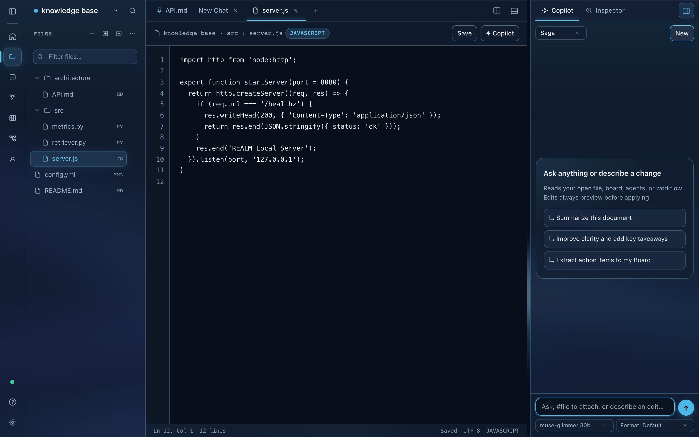
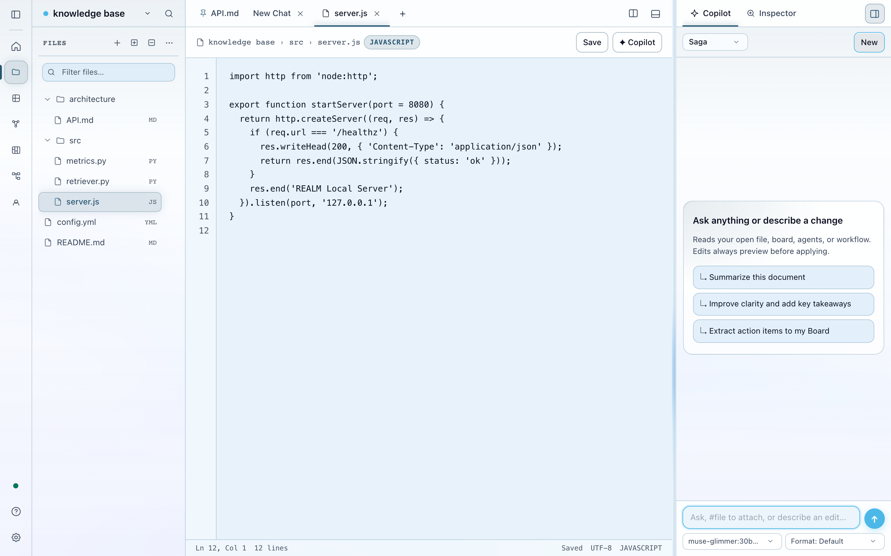

# REALM Knowledge Engine (`realm-engine`)

A local-first, privacy-hardened **AI Knowledge Workbench, Hybrid RAG Engine & Code/Document Copilot** built with FastAPI, strict Pydantic v2 contracts, and a Gemini-Stitch luminous glass desktop & web interface (Dark & Light WCAG 2.1 AA themes, English / Deutsch / Español).

Drop in **Markdown, PDF, Office (`.docx`, `.xlsx`, `.pptx`, `.csv`, `.tsv`), HTML, or 35+ source-code and config formats** (`.py`, `.js`, `.ts`, `.tsx`, `.json`, `.yml`, `.css`, `.sql`, `.sh`, `.rs`, `.go`, `.swift`, `.dart`, and more) — or **link existing folders in place** — and work with them inside a 4-zone IDE layout featuring grounded multi-turn AI chat, a **Right Sidebar Context-Aware Copilot (`⌘J`)**, **Built-in Private AI** (zero external Ollama setup required), **Work OS** (Kanban, Calendar, Focus & Impact), **Visual Workflows Studio**, an interactive **2D Knowledge Graph**, **Study Cards**, offline **Audio Briefings**, and built-in **GDPR/DSGVO PII redaction**.



<details>
<summary>Preview Light (Clear) Mode</summary>



</details>

---

## Highlights

- **100% Local-First & Private by Default:** Starts with **Strict Local-Only Lock** enabled, zero external CDN or telemetry requests, loopback-only binding, strict Host/Origin/CSRF/CSP middleware, `0o600` owner-only local secret storage, and automatic skipping of `.env*`, credentials, lockfiles, and build folders (`node_modules/`, `dist/`, `.venv/`, `__pycache__/`).
- **Built-in Private AI + Ollama + 7 Cloud Providers:** Run offline out of the box with REALM's managed **`llama-server` sidecar** (5-tier hardware-matched Apache 2.0 catalog) or connect local [Ollama](https://ollama.com/download), or optionally unlock OpenAI, Gemini, Anthropic, Kimi, DeepSeek, xAI, and Mistral behind a daily spend guard.
- **4-Zone IDE Workbench & Code/Markdown Editor:**
  - **Left Activity Rail & Files Explorer:** `Home`, `Files` (live filter, `Expand/Collapse All`, `Auto-reveal`, `Always open in new tab` / preview mode, `+ New File` / `+ New Note`, Rename, Duplicate, Move, Folder menus, GDPR Anonymize, Delete), `Library`, `Graph`, `Work OS`, `Workflows`, and `Agents & Formats`.
  - **Center Tabbed Workspace:** Open Markdown files in **Preview / Raw / Side by Side** or source/config files in a **Code Editor tab** (language badge, synced line-number gutter, `Ln/Col` status footer, `⌘S` save, 2-space `Tab` indent). Right-click tabs to **Pin / Unpin** (persisted across reloads) or bulk close (`Close Others`, `Close to the Right`, `Close Saved`, `Close All`).
  - **Live Status Indicators & Unsaved Guard:** Chat tabs and Recent Chats show a live **Working spinner** while streaming in the background and switch to a glowing **Unread dot** when finished while you're reading a file; modified files show a **Modified dot** on both the tab and Files tree, protected by an app-wide **Save / Discard / Keep editing** modal (including desktop window close).
  - **`⌘P` Quick Open File & `⌘K` Command Palette:** Jump to any workspace file or action from the keyboard.
- **Context-Aware Right Sidebar Copilot (`⌘J`):**
  - Reads your active open file, Work OS board, workflow canvas, or agent roster. Choose any **Agent**, **Model**, and **Output Format** per reply.
  - **Highlight-to-Copilot:** Select text in Preview, Raw, or Code view to trigger `✦ Ask Copilot` / `✦ Edit Selection`.
  - **`#file` Multi-Document References:** Type `#` inside Copilot to attach up to 4 workspace files as removable context chips (keeping `@` for agents and `/` for commands).
  - **Safe Human-in-the-Loop Actions:** Proposals preview inline diffs and apply only on click, with **persistent threads** per workspace/context and **universal 1-click Undo** across document edits, notes, tasks, events, goals, workflows, and agents.
- **Hybrid RAG + Engine Inspector (`⌘I`):** Punctuation-safe BM25 + cached vector embeddings (`index.json` with schema/model versioning) + Reciprocal Rank Fusion (`RRF`), Query Intent Auto-Router, Context Window meter, lossless **Compress Context**, and per-passage Pin/Mute Retrieval X-Ray.
- **Work OS, Visual Workflows & Specialist Agents:** Built-in **Kanban Board & Calendar**, **Focus Seasons & Goals**, **Time & Impact ROI Ledger**, drag-and-drop **Visual Workflows Studio**, **8 built-in + custom specialist agents** (`@mention`, per-agent model pinning), **13 structured Answer Formats**, **Study Cards** (Anki `.tsv` + Socratic Quiz), **Knowledge Gap Scan**, and offline Solo/Duo **Audio Briefings**.
- **Accessibility, Themes & Multilingual UI:** **English**, **Deutsch**, and **Español**; **15 WCAG 2.1 AA Dark/Light palettes** with a clean **Fix Global Theme** toggle (follow each active agent by default, or lock one theme everywhere); Atkinson Hyperlegible & OpenDyslexic-style fonts, S–XL text scaling, High-Contrast Focus, Reduce Motion, and **Eco Mode**.
- **Developer & Headless Integrations:** Opt-in loopback-only **OpenAI-compatible `/v1` API**, terminal CLI (`realm-engine ask`), **stdio MCP server** (`realm-engine mcp`) for Claude Desktop / Cursor / VS Code, and **Headless Read-Only Public API** (`REALM_MODE=public`).

---

## Quickstart

### Download Desktop App (macOS & Windows)

Download signed/packaged releases from [**GitHub → Releases**](https://github.com/realmframework/realm-engine/releases):

| Platform | Download | Install & Notes |
|---|---|---|
| **macOS — Apple Silicon (M1–M4, 2020+)** | `REALM-Engine-<ver>-macos-apple-silicon.dmg` | Open the `.dmg`, drag **REALM Engine** to **Applications**, and launch. Native WebKit desktop window with clean `⌘Q` shutdown. |
| **macOS — Intel** | `REALM-Engine-<ver>-macos-intel.dmg` | Open the `.dmg`, drag **REALM Engine** to **Applications**, and launch. |
| **Windows 10 / 11 (64-bit)** | `REALM-Engine-<ver>-windows-x64-setup.exe` *(or `-portable.zip`)* | Run the per-user installer (no Admin needed, EN/DE/ES wizard) or extract the portable folder. Uses Edge WebView2 automatically and falls back cleanly to your default browser if WebView2 is absent. |

- **Private desktop storage:** Vaults, chats, logs (`logs/realm-engine.log`, `0600`), and saved API keys live in `~/Library/Application Support/REALM Engine/` (macOS), `%APPDATA%\REALM Engine\` (Windows), or `~/.local/share/realm-engine/` (Linux).
- **Verify downloads:** Every release ships a `SHA256SUMS.txt` checksum manifest. Maintainer build, signing, and Apple notarization instructions live in [packaging/RELEASING.md](packaging/RELEASING.md).

### Run From Source (macOS, Windows & Linux)

Install [uv](https://docs.astral.sh/uv/), then launch directly:

- **macOS:** Double-click `start.command` (or `./start.command`)
- **Windows:** Double-click `start.bat` (or `start.bat`)
- **Linux:** Run `./start.sh`

All launchers run `uv run python main.py --desktop` on `http://127.0.0.1:8000`. To launch the native WebView window from source, run `uv run --group desktop python desktop_app.py`.

### CLI, Python Package & MCP Server

```bash
# Local web server (open http://127.0.0.1:8000)
uv run python main.py

# Or via the installed console script (pip / uv tool install)
realm-engine --port 8080 --data-dir /path/to/my-vaults

# One-shot grounded CLI query (optional --json, --area, --model)
realm-engine ask "Summarize our deployment checklist"

# Start stdio Model Context Protocol (MCP) server for Claude Desktop / Cursor / VS Code
realm-engine mcp

# Pre-build index.json embeddings offline (ollama | openai | mistral | gemini)
uv run python main.py --build-index --embed-provider ollama

# Print application version
realm-engine --version
```

### Docker / Docker Compose

```bash
docker compose up
```

Open `http://127.0.0.1:8000` (override host port with `REALM_PORT`). Runs as an unprivileged user (`uid 1000`, `HOME=/data`) and persists vaults and settings in the `realm-data` volume.

---

## Documentation

| Guide | What It Covers |
|---|---|
| [User Guide](docs/USER_GUIDE.md) | Workspaces, 45+ doc/code formats, Linked Folders, Code & Markdown tabs, Copilot (`⌘J` / `#file`), `⌘P` Quick Open, `⌘K` Command Palette, Work OS, Workflows, Inspector (`⌘I`), Study Cards, Audio Briefings, 2D Graph, and Backups. |
| [Agents & Answer Formats](docs/AGENTS_AND_FORMATS.md) | Built-in & custom agents, `@mention` syntax, per-agent model pinning & RAM safety, Second Opinion, 13 structured Answer Formats, and PDF/Markdown synthesis. |
| [Integrations & Public API](docs/INTEGRATIONS.md) | Local OpenAI-compatible `/v1` API, `realm-engine ask` CLI, `realm-engine mcp` setup, and Headless Read-Only Public API (`REALM_MODE=public`). |
| [Privacy, Security & Compliance](docs/PRIVACY_AND_COMPLIANCE.md) | Threat model, Strict Local-Only Lock, localhost CSRF/SSRF/CSP perimeter, Copilot prompt-injection defense, secret-file ignores, GDPR/DSGVO redaction, and EU AI Act audit reports. |
| [Packaging & Releasing](packaging/RELEASING.md) | Building macOS `.dmg` (signed & notarized), Windows `.exe`/`.zip`, Linux launchers, Python wheels, and Docker images. |
| [Security Policy](SECURITY.md) | Responsible vulnerability disclosure and supported versions. |
| [Contributing](CONTRIBUTING.md) | Architectural rules, local verification gate, and pull request workflow. |
| [Changelog](CHANGELOG.md) | Release history and notable changes. |

---

## Architecture & Development

Every run enforces strict architectural boundaries in [core/test_architecture.py](core/test_architecture.py):

- **Strict Vertical Slices:** Feature slices live under `features/` (`ingestion`, `search`, `tutor_agent`, `copilot`, `local_ai`, `work_board`, `focus`, `impact_ledger`, `workflows`, `slides`, `ui`) with zero cross-slice imports (`features/ui/app.py` is the composition root).
- **Contract-First:** Shared Pydantic v2 models live in `core/` with `ConfigDict(strict=True)`.
- **Line Ceilings:** Backend Python files stay `<= 150` lines; frontend template/script modules in `features/ui/` and static `.js`/`.css` assets stay `<= 350` lines.

### Verification Gate

```bash
uv run ruff check . && uv run pyright && uv run pytest
```
